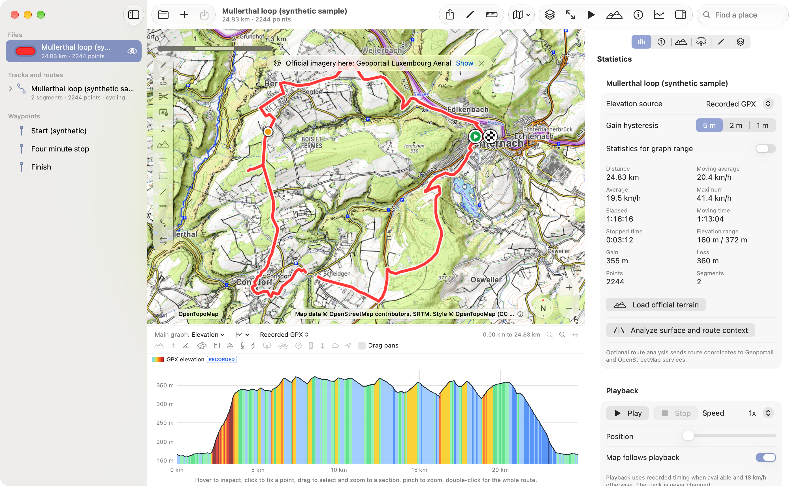
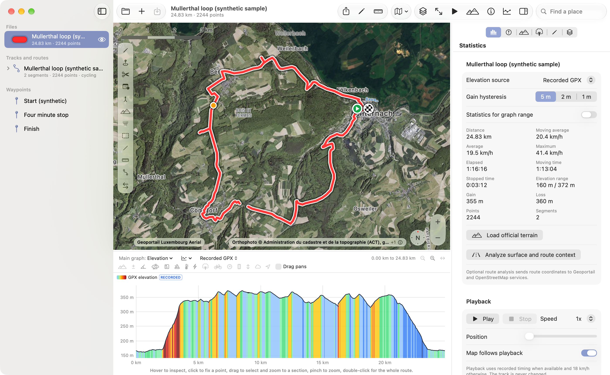
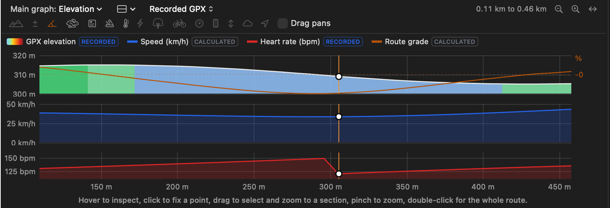
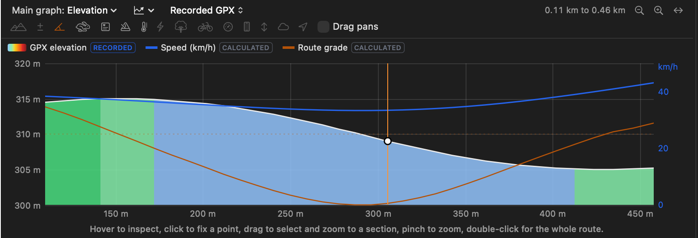
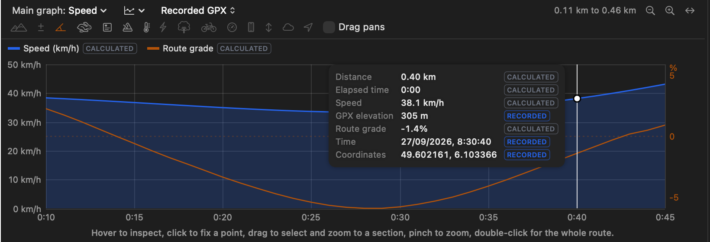

# GPX Viewer

A desktop application for viewing, analysing and editing GPS tracks, with official and open maps, elevation profiles coloured by gradient and detailed activity data. Native on macOS (Apple silicon and Intel), with a separate Windows edition.

Free software under the MIT License. No account, no analytics, no advertising: your files stay on your computer.

This repository is the project's home on GitHub: documentation, release metadata, screenshots, the GitHub Releases with the installers, and the source of the official website in [`website/`](website/). The application's source code is published with each release on SourceForge and attached to the GitHub Releases.

Official website: **https://gpxviewerpro.pages.dev/**

## Screenshots

GPX Viewer 0.2.0 for macOS with synthetic GPX files.

## Features

- **Files:** GPX 1.0 and 1.1 tracks, segments, routes and waypoints; heart rate, cadence, power and temperature extensions; several files at once; File Info shows which device and application recorded a file. The original file is never changed.
- **Maps:** Apple Maps (Mac), OpenStreetMap, OpenTopoMap, CyclOSM; official aerial and topographic maps from Luxembourg, Belgium, France, the Netherlands, Switzerland, Austria and Germany; Thunderforest, Esri, Azure Maps, TomTom, HERE and Mapbox with your own key. Credits always visible.
- **Graphs:** elevation coloured by gradient; on Mac, a selectable main graph among fourteen measurements, combined and stacked layouts, distance, elapsed or moving time axes; graph and map in step.
- **Analysis:** distance, elapsed, moving and stopped time, speeds, gain and loss with a selectable threshold, climbs, statistics for any section, point inspection with recorded and calculated values labelled.
- **Terrain and context:** official terrain heights, 3D relief, surface and route context analysis.
- **Historical weather (macOS 0.3.0, both Mac editions):** estimated weather for the time and places of a recording from the Open-Meteo archive, retrieved only when you ask: temperature, wind against your direction of travel, precipitation, humidity, pressure and cloud cover, a timeline linked to the map and graph, and eight weather lines on the graph. Values are model estimates, marked Modelled and kept apart from sensor readings. Not in the Windows edition or Web Lite.
- **Editing:** route drawing with routing, split, merge, simplify, clean, reverse, time and elevation tools, all with undo.

What each edition provides, feature by feature: [docs/FEATURES.md](docs/FEATURES.md).

## Platforms

<!-- platforms:start -->
| Platform | Status | Current version | Architecture |
| --- | --- | --- | --- |
| macOS for Apple silicon | Released | 0.3.0 | arm64 |
| macOS for Intel | Released | 0.3.0 | x86_64 |
| Windows | Released | 0.3.0 | x64 |
| iPhone | In development, no public release |  | arm64 |
| Android | No public build |  |  |
| Wear OS extension | On hold |  |  |
<!-- platforms:end -->

## Downloads

<!-- downloads:start -->
| Edition | Requirements | Installer | Size | SHA-256 |
| --- | --- | --- | --- | --- |
| macOS for Apple silicon | macOS 13 Ventura or later on a Mac with Apple silicon (M1 or later) | [GPX Viewer 0.3.0 Apple Silicon macOS 13+.pkg](https://sourceforge.net/projects/gpx-viewer/files/macOS/0.3.0/ARM64/GPX%20Viewer%200.3.0%20Apple%20Silicon%20macOS%2013%2B.pkg/download) | 4.5 MB | `1036e9d2454673f449bb6cb66d16d0ce896a6d23236958e5f80c76f5f46b1711` |
| macOS for Intel | macOS 10.13 High Sierra to macOS 12 Monterey on an Intel Mac | [GPX Viewer 0.3.0 Intel macOS 10.13-12.pkg](https://sourceforge.net/projects/gpx-viewer/files/macOS/0.3.0/X64/GPX%20Viewer%200.3.0%20Intel%20macOS%2010.13-12.pkg/download) | 6.2 MB | `70ea3288940ffacbeec8315dc607f21e4bf2201c76a03647a225af089707d312` |
| Windows | Windows 10 version 1809 or later, or Windows 11, 64-bit | [GpxViewer-0.3.0-Setup-x64.exe](https://sourceforge.net/projects/gpx-viewer/files/Windows/0.3.0/GpxViewer-0.3.0-Setup-x64.exe/download) | 45.3 MB | `691445205bed57f0ca5578252836cbc1c686e0ed46b382f3a369ae77acab7626` |

Released: macOS 0.3.0 on 25 October 2026, Windows 0.3.0 on 12 October 2026. Files are hosted on [SourceForge](https://sourceforge.net/projects/gpx-viewer/files/). Archived releases are listed in [CHANGELOG.md](CHANGELOG.md).
<!-- downloads:end -->

The installers are not signed with a developer certificate. On macOS, Control-click the package and choose Open (macOS 15 and later: System Settings, Privacy and Security, Open Anyway). On Windows, SmartScreen may warn about an unknown publisher. Always compare the SHA-256 checksum: [docs/INSTALLING.md](docs/INSTALLING.md).

## Known limitations

<!-- limitations:start -->
- Weather values are model estimates for grid cells of about 9 to 25 km and whole hours, not measurements at the track.
- The most recent days can be missing or provisional until the archive is updated.
- Uses Open-Meteo's free service for non-commercial use; very heavy use can be rate limited.
- Not signed with an Apple Developer ID and not notarized.
- Tested on macOS 27 (Apple silicon; the Intel edition under Rosetta). Historical Weather has not been tested on macOS 10.13 to 12 hardware.
- The installer is not code-signed: Microsoft Defender SmartScreen may warn about an unknown publisher. Choose More info, then Run anyway, only for a file downloaded from the GPX Viewer SourceForge project.
<!-- limitations:end -->

## Documentation

- [Installing and verifying downloads](docs/INSTALLING.md)
- [Features by edition](docs/FEATURES.md)
- [Changelog](CHANGELOG.md)
- [Official website](https://gpxviewerpro.pages.dev/) with GPX Viewer Web Lite (a viewer that runs in the browser) and the full documentation. Its source is in [`website/`](website/).
- [GitHub Releases](https://github.com/A097MPRUS/GPX-Viewer/releases): installers, source archive and checksums of each macOS release (the same files are on SourceForge).
- [SourceForge project](https://sourceforge.net/projects/gpx-viewer/): downloads, source archives, tickets.

## Reporting problems

Open an issue with the templates in this repository, or a ticket on SourceForge. Please do not attach private recordings; a short synthetic file that shows the problem is enough. Security issues: see [SECURITY.md](SECURITY.md).

## Licence and notices

- GPX Viewer's own code and documentation: [MIT License](LICENSE), © 2026 A097MPRUS.
- [Legal notice (version 6)](LEGAL_NOTICE.md): not for navigation, map, data and weather owners, liability.
- [Privacy](PRIVACY.md) and [third-party services, data and software](THIRD_PARTY.md).

## Acknowledgements

Maps and data belong to their owners: Apple, the OpenStreetMap contributors, OpenTopoMap, CyclOSM and OpenStreetMap France, Waymarked Trails, EOX, Thunderforest, Esri, Microsoft, TomTom, HERE, Mapbox, and the national mapping agencies of Luxembourg (ACT), Belgium (SPW, Digitaal Vlaanderen, UrbIS, NGI), France (IGN), the Netherlands (PDOK, Kadaster), Switzerland (swisstopo), Austria (basemap.at) and Germany (BKG and the state survey offices). Routing by BRouter. Terrain from Geoportail Luxembourg, IGN and the Terrain Tiles open dataset. Historical weather: weather data by Open-Meteo.com (CC BY 4.0), based on data and products of ECMWF and containing modified Copernicus Climate Change Service information.

Apple, Apple Maps, Mac and macOS are trademarks of Apple Inc. Windows is a trademark of Microsoft Corporation. GPX Viewer is an independent project and is not affiliated with them.
